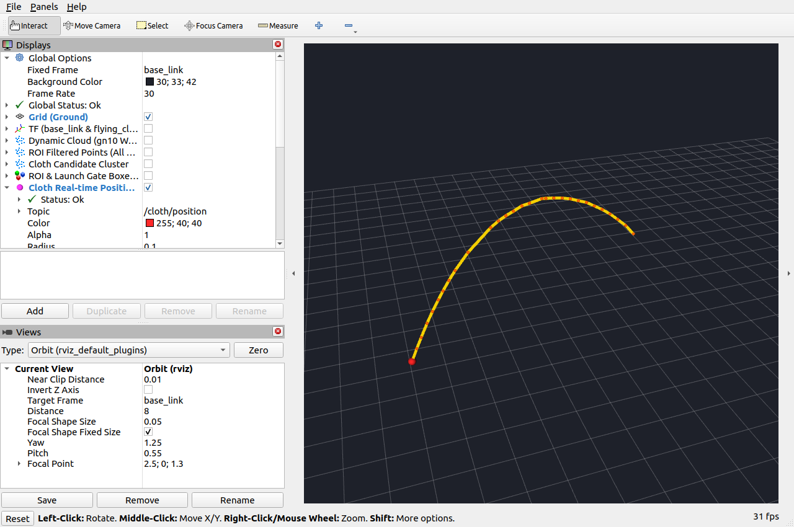
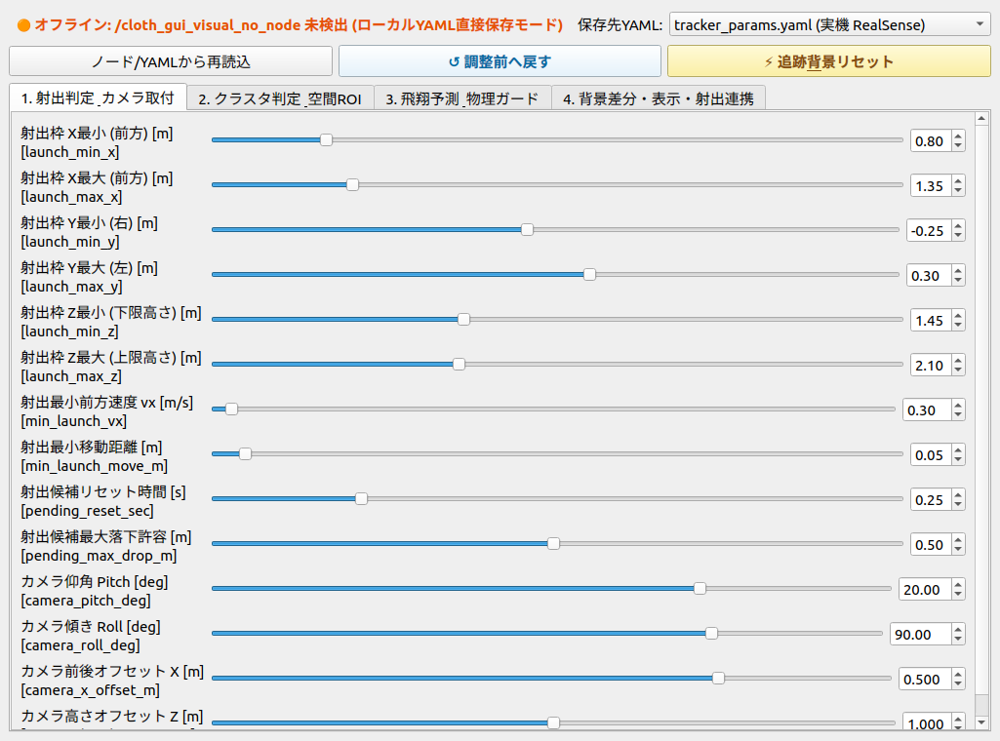

# realsense_dust_cloth

RealSenseの深度画像から飛翔中の雑巾を追跡するROS 2 Humble / CUDAパッケージです。

**現在の標準経路は、GPUの深度リングバッファによる背景差分と予測追跡です。** 実機・Unity・カメラだけのbagで動かす場合、地図・自己位置・gn10・`shot_count`は必須ではありません。外部点群の再投入経路も残しています。

このREADMEはPR #8の修正ブランチの仕様です。2026-11-06のUnity試験では6投捕捉、`LANDED`出力4投、旋回後2投は終盤に`LOST`でした。毎回の着地追跡成功やJetsonの負荷削減率は保証していません。詳細は [検証・負荷の記録](JETSON_LOAD_REVIEW_20261106.md) を参照してください。

## 処理の流れ

```text
USB直結、または深度画像＋CameraInfo
  → GPUで背景差分・座標変換・ROI・Voxel間引き
  → 候補クラスタを抽出
  → 射出枠での移動を確認
  → 予測位置・大きさ・速度・加速度で追跡
  → 実測位置・軌跡・終了状態を配信
```

- 起動後の最初の画像で背景を作ります。その画像に写っている雑巾は背景に含まれるため、カメラ入力が始まってから射出してください。
- 以後は候補を調べた後、候補がない待機フレームだけで背景を更新します。検出前に現在画像を背景へ取り込みません。
- 射出候補が発射枠に現れると背景を凍結します。`/robot/feedback/shot_count`が利用可能なら、カウント変化でも凍結できます。未実装でも自動検知で動作します。
- 飛翔中は背景を更新しません。凍結期限を過ぎ、追跡が終了していれば背景更新へ戻ります。
- 現方式は`cmd_vel`や車輪速度で停止を直接判定しません。停止後の背景安定時間は実FPS・リング長・更新周期によるため、「必ず停止後0.1秒」とは限りません。

## ビルド

JetsonではCUDA・librealsense2開発SDK、PCでの画像トピック入力にはCUDAが必要です。

```bash
source /opt/ros/humble/setup.bash
cd ~/ros2_ws
rosdep install --from-paths src/realsense_dust_cloth --ignore-src -r -y
colcon build --symlink-install --packages-select realsense_dust_cloth
source install/setup.bash
```

直結モードでlibrealsense2がない場合は、黙って画像購読へ切り替えず起動エラーにします。同じUSBカメラを別のRealSenseノードと同時に開かないでください。

## YAMLを1つ選んで起動

| YAML | 用途 | `use_sim_time` | `use_direct_realsense` | 標準入力 |
|---|---|---|---|---|
| `tracker_params.yaml` | Jetson実機 | false | true | USB深度 |
| `unity_params.yaml` | Unity | true | false | 深度トピック |
| `rosbag_params.yaml` | カメラbag | true | false | 深度トピック |

取付位置・ROI・数値・時計・補助ノードは選択したYAMLが正本です。launchは値を暗黙に上書きしません。

### Jetson実機

```bash
source /opt/ros/humble/setup.bash
source ~/ros2_ws/install/setup.bash
ros2 launch realsense_dust_cloth cloth_tracker.launch.py
```

この深度経路にlocalizationの起動は不要です。ロボットの別の機能でlocalizationを使っていても併用できます。

### Unity

UnityとROSノードで同じ`ROS_DOMAIN_ID`を使用します。

```bash
source /opt/ros/humble/setup.bash
source ~/ros2_ws/install/setup.bash
export ROS_DOMAIN_ID=96
ros2 launch realsense_dust_cloth cloth_tracker.launch.py \
  cloth_tracker_params_file:=unity_params.yaml
```

`use_sim_time`や`use_direct_realsense`をlaunch引数で追加する必要はありません。Unity側から深度・CameraInfo・`/clock`を配信してください。検証用の`ROS_LOCALHOST_ONLY=1`は同じPC内だけで使い、JetsonとPCの通信時には設定しません。

### カメラbag

```bash
# ターミナル1
source /opt/ros/humble/setup.bash
source ~/ros2_ws/install/setup.bash
export ROS_DOMAIN_ID=95
ros2 launch realsense_dust_cloth cloth_tracker.launch.py \
  cloth_tracker_params_file:=rosbag_params.yaml

# ターミナル2（同じROS環境とROS_DOMAIN_IDを設定）
ros2 bag play /path/to/bag --clock 100 --topics \
  /camera/camera/depth/image_rect_raw /camera/camera/depth/camera_info
```

現在のrosbag用YAMLは`start_rviz: true`です。RVizを別PCで開く場合はfalseにします。

Unityで記録した`/clock`をそのまま再生する場合は、`--clock`を付けず、再生トピックに記録済み`/clock`を加えます。生成時計と記録時計を同時に配信しないでください。画像ヘッダーと`/clock`の時刻が一致している必要があります。

記録済みの`/cloth/position`・状態・マーカーを同時に再生すると、新しい追跡結果と混ざります。入力トピックだけを選択してください。深度bagではYAMLの取付位置・角度を撮影時に合わせます。

## PCのRViz2で追跡を見る

JetsonとPCで同じ`ROS_DOMAIN_ID`を設定し、ROS 2通信が通るようにします。PC側でもパッケージをビルドしておきます。

```bash
source /opt/ros/humble/setup.bash
source ~/ros2_ws/install/setup.bash
rviz2 -d ~/ros2_ws/src/realsense_dust_cloth/rviz/cloth_tracker.rviz
```

Unity・bagを見るRVizにはシミュレーション時計を指定します。

```bash
rviz2 -d ~/ros2_ws/src/realsense_dust_cloth/rviz/cloth_tracker.rviz \
  --ros-args -p use_sim_time:=true
```

Fixed Frameは`base_link`（YAMLの`camera_parent_frame`を変えた場合はそれに合わせます）。赤い点が最後の実測位置、黄色い線と点が実測軌跡です。`LOST`でも最後の位置を残します。表示が残っていること自体は追跡継続を意味しません。

**通常表示では点群・ROI・TF・重複するPath表示を無効にしています。** 位置と黄色い軌跡は点群なしで見られます。PathやTFも必要なときに有効にしてください。原因を調べるときだけ、次の表示を有効にしてください。

| RViz表示 | トピック | 用途 |
|---|---|---|
| ROI Filtered Points | `/cloth/debug/filtered_points` | ROI・背景差分・間引き後の点群 |
| Cloth Candidate Cluster | `/cloth/debug/cluster_points` | 今回採用した候補クラスタ |
| ROI & Launch Gate Boxes | `/cloth/debug/roi_markers` | 探索空間・射出枠 |
| Dynamic Cloud (gn10) | `/realsense/dynamic_cloud` | 外部点群経路だけ。標準の深度経路では使わない |

点群・ROIの表示には`publish_debug_cloud: true`が必要です。点群は購読者がいる表示フレームだけ抽出し、`debug_publish_hz`（標準5Hz）で配信します。位置・TFの追跡周期は維持し、軌跡メッセージは`static_marker_interval_sec`（標準0.1秒）で表示します。開始・終了は直ちに表示します。



表示確認時の追加射出も終盤でLOSTでした。画像は軌跡を表示できることの確認であり、着地成功を示すものではありません。

## パラメータ調整GUI

```bash
source /opt/ros/humble/setup.bash
source ~/ros2_ws/install/setup.bash
ros2 run realsense_dust_cloth param_tuner_gui.py --profile tracker_params.yaml
# Unity用なら --profile unity_params.yaml
```

PCとJetsonは同じ版をビルドしてください。古いノードにはGUIの新しい項目が未実装の場合があります。

PCからJetsonを調整するときも同じ`ROS_DOMAIN_ID`にします。接続中はノードの実際の値を読み込み、変更が受理されたら選択したローカルYAMLへ保存します。オフラインではローカルYAMLだけを編集します。コメントは維持します。

保存先は初期指定プロファイル1つです。「全プロファイル同期」を明示的に選んだ場合だけ3種類へ保存します。**PCで開いたGUIが保存するのはPC上のYAMLです。Jetson上のファイルを遠隔で書き換える機能ではありません。** Jetson再起動後も残すには、調整した設定をJetsonにも反映してください。

### 2種類のリセット

| ボタン | 動作 |
|---|---|
| **調整前へ戻す** | このGUIを開いた後に変更した項目を、変更前のノード値・各YAMLの値へ戻す。再読込しても戻し先は保持する |
| **追跡&背景リセット** | `/cloth/reset`へEmptyを送り、追跡状態・背景リング・内部の軌跡履歴をリセットする。パラメータは元に戻さない |

「調整前へ戻す」は固定の工場値や古いコミット値ではありません。環境ごとに異なる元値を保ち、このGUIが変更した項目だけを戻します。GUIを閉じると戻し先の記録は失われます。接続中に変更したノードを戻すには、そのノードへ接続できる必要があります。

「ノード/YAMLから再読込」は現在値の再取得であり、変更取り消しではありません。手動でYAMLを書き換えた場合はノードを再起動してください。`ros2 param set`だけではYAMLへ保存しません。



## Jetsonの負荷・Wi-Fi帯域を抑える

通常運転の実機YAMLは、カラー・生深度配信・Jetson上のRViz・解析・bag記録を無効にしています。USBから取得する追跡用深度は60fpsのままです。

| 項目 | 設定・実装 |
|---|---|
| 生深度の遠隔配信 | `publish_raw_depth: false`。明示許可＋購読者がいる場合だけ配信 |
| カラー | `enable_color_stream: false`。必要時だけ有効化 |
| 点群表示 | 購読者がいる点群だけ抽出。標準最大5Hz |
| 軌跡・Path | 購読者がいる出力だけ組み立て、標準0.1秒間隔で表示 |
| 状態 | 変化したときだけ配信。Transient Localなので後から接続した購読者も最新値を取得できる |
| ログ | 毎実測点の詳細ログはDEBUG。射出・終了・拒否理由はINFOで確認可能 |

640×480の生深度16bit・60fpsは画像データだけで約295Mbps、生カラー24bit・30fpsは約221Mbpsです。RealSense→JetsonのUSB取得自体はWi-Fiを使いません。遠隔のRVizやbag記録が大きなトピックを購読するとWi-Fiへ流れます。JPEGを見るときも同時に生画像を購読しないようにします。

Jetson内で生深度bagを記録する場合は`publish_raw_depth: true`にしてください。falseのままでは、記録対象へ指定しても画像は届きません。CameraInfoだけを購読しても生深度画像は配信しません。

**最大限の最適化が済んだとは言えません。** クラスタ結合には全点対比較O(N²)が残り、8192点なら約3355万組/フレームを調べます。点数が多い場面や、同じJetson上の別ノードと競合する場面は実機で測定が必要です。推測で追跡FPSを落としたり、軌跡を偽って補完したりはしていません。

Jetsonで`tegrastats --interval 1000`を実行し、RVizなし／軌跡だけ／点群ありでCPU・GPU・メモリ・クロックを比較してください。別ノードのLiDAR点群・地図配信も通信量へ加わります。このPC上の測定だけでJetsonの負荷削減率を断定しません。

## 外部点群経路を使う場合

`input_source`をYAMLで選びます。標準の`depth`経路では、外部点群の購読・外部結果待ち監視は起動しません。

- `depth`: 深度画像からGPU背景差分・追跡。地図・自己位置は不要。
- `dynamic_cloud`: 記録済み／外部の`/realsense/dynamic_cloud`を追跡。上流が消した点は復元できない。
- `cropped_cloud`: `/bag/realsense/cropped_cloud`から除去前点群を受信し、gn10へ再投入して差分後点群を追跡。gn10の地図・自己位置・TFが必要。

外部経路での予測保護球は`/cloth/filter_prediction`、gn10への入力は`/realsense/cropped_cloud`です。RealSense点群をLiDAR自己位置推定そのものへ投入する構成ではありません。

## 状態と切り分け

| 状態・症状 | 確認するもの |
|---|---|
| `WAITING_FOR_CAMERA_INFO` | 深度と対応するCameraInfo、トピック名 |
| `IMAGE_TIME_INVALID` | 時計・画像ヘッダー時刻・入力遅延 |
| `RESULT_TIMEOUT` / `FILTER_*` | 外部経路の点群・gn10・TF・地図。標準の深度経路には不要 |
| `IDLE`のまま | 背景への取り込み、ROI、発射枠、最小点数・変位 |
| `LOST` | ログの拒否理由、床付近の背景除去、候補クラスタ、物理条件 |
| `Depth voxel capacity exceeded` | 点数超過。ROI・Voxelサイズを確認。黙って点を切り捨てない |

- `TRACKING`: 実測候補を追跡中。
- `LANDED`: 採用した実測点が`landing_min_z`以下。別物を採用すれば誤判定もあり得るため、正解ラベルではない。
- `LOST`: 欠測・異常候補・時間切れで終了。着地扱いにはしない。
- `RESTING`: 着地高さより上で静止。着地成功とは別。
- `/cloth/position`・`/cloth/measured_path`は採用実測。予測だけの点を混ぜない。
- `/cloth/landing_position`はLANDED時のみ。`/cloth/tracking_state`で状態を確認する。
- `/cloth/ready`は準備状態の通知で、射出装置を禁止する機構ではない。

## 実装・検証の入口

| ファイル | 役割 |
|---|---|
| `src/camera_input.cpp` | 背景更新・凍結・深度トピック入力 |
| `src/realsense_camera.cpp` | USB直結と画像配信 |
| `src/cuda_kernels.cu` | 背景差分・ROI・間引き・クラスタ |
| `src/ballistic_tracker.cpp` | 射出確認・予測・物理条件 |
| `src/tracking_output.cpp` | 位置・TF・軌跡表示 |
| `src/tracking_status.cpp` | 状態変化の配信 |
| `src/tracker_parameters.cpp` | YAML読込・実行中の変更 |
| `src/external_cloud_tracking.cpp` | 外部差分点群経路 |
| `realsense_dust_cloth/param_tuner_gui.py` | GUI・調整取り消し・選択YAMLへの保存 |

```bash
colcon test --packages-select realsense_dust_cloth
colcon test-result --verbose
```

GPUを使うテストはCUDAデバイスがない環境ではスキップします。テスト用ROSドメインは実機と分けます。古い構成・整理時の記録は`CHANGES_20261102.md`と`CODE_STRUCTURE.md`に残しています。
